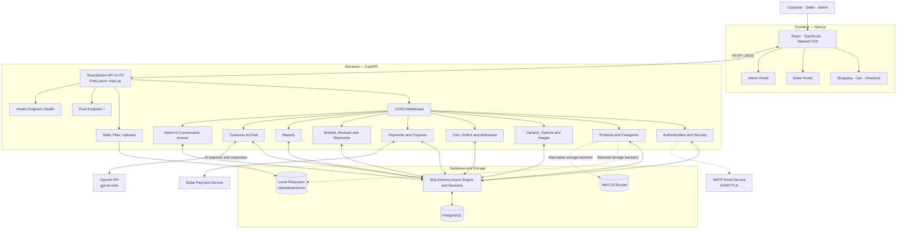

# ShopSphere — System Architecture

ShopSphere is an AI-powered multi-vendor e-commerce platform with customer, seller, and administrator functionality.

## Architecture Diagram

## Backend Components

- Application entry point: `main.py`
- Backend framework: FastAPI
- API documentation: FastAPI-generated OpenAPI and Swagger UI
- Cross-origin requests: CORS middleware
- Authentication and security: `app/api/auth.py` and `app/core/security.py`
- Products and categories: `app/api/product.py` and `app/api/category.py`
- Product variants, options, and variant images
- Cart, orders, addresses, and payments
- Wishlist, reviews, coupons, and shipments
- Reports and administrator AI conversation access
- Customer AI shopping assistant: `app/api/chat.py`
- Static uploaded files: `/uploads`
- Root endpoint: `/`
- Health endpoint: `/health`

## Technology Stack

- Frontend: Next.js, React, TypeScript, and Tailwind CSS
- Backend: Python and FastAPI
- Database: PostgreSQL
- Database access: SQLAlchemy asynchronous engine and sessions
- Database configuration: `DATABASE_URL` environment variable
- Schema migrations: Alembic
- Authentication: Application authentication and security modules
- Payments: Stripe SDK configured in `app/core/stripe.py`
- AI assistant: OpenAI API using the `gpt-4o-mini` model
- Email: SMTP with STARTTLS, configured in `app/services/email.py`
- Image storage: Local filesystem or AWS S3, selected through `STORAGE_BACKEND`

## Storage Configuration

The storage utility in `app/utils/storage.py` selects the storage backend as follows:

- If `STORAGE_BACKEND=local`, product images are stored under `uploads/products`.
- If `STORAGE_BACKEND=s3`, product images are uploaded to the configured AWS S3 bucket.
- If `STORAGE_BACKEND` is not set, the code defaults to S3 when `VERCEL=1` and local storage otherwise.
- The default AWS region is `ap-south-1`.
- If `AWS_S3_PUBLIC_BASE_URL` is configured, it is used as the base URL for generated S3 image links.
- S3 configuration uses the relevant AWS credentials, region, and bucket settings.

The FastAPI application mounts the `uploads` directory at `/uploads`. This endpoint serves files available in the local uploads directory. It does not directly serve files stored in S3.

Local storage must be persistent in the deployment environment for uploaded files to remain available. The diagram represents local storage and S3 as alternative backends, not as two locations where every image is automatically saved.

## Database and Migrations

The database module in `app/database/database.py` reads `DATABASE_URL` and creates an asynchronous SQLAlchemy engine and session factory.

The configured database dialect was verified as PostgreSQL.

Alembic manages database schema migrations. The deployed database schema should remain consistent with the SQLAlchemy models and migration history.

## External Integrations

### Stripe Payments

The Stripe configuration is located in `app/core/stripe.py` and uses `STRIPE_SECRET_KEY` and `STRIPE_WEBHOOK_SECRET`.

The presence of Stripe configuration does not by itself confirm that production payments and webhook processing work correctly.

### OpenAI AI Assistant

The customer AI chat implementation is located in `app/api/chat.py`. It uses `OPENAI_API_KEY` and the `gpt-4o-mini` model.

Customer chat conversations and assistant responses are stored in the database according to the chat implementation.

Successful AI responses depend on valid credentials, network connectivity, and provider availability.

### SMTP Email

The email service is located in `app/services/email.py` and uses SMTP with STARTTLS.

Email configuration uses environment variables such as `SMTP_HOST`, `SMTP_PORT`, `SMTP_USERNAME`, and `SMTP_PASSWORD`.

The authentication routes import and use `send_email` for email verification workflows. Actual email delivery depends on valid SMTP configuration and provider availability.

### AWS S3

S3 storage requires the appropriate AWS credentials and bucket configuration when `STORAGE_BACKEND=s3` is selected.

Generated image URLs must be accessible to the frontend for product images to display correctly.

## API Registration

The root `main.py` registers the following API areas:

- Categories and products
- Authentication
- Cart, orders, addresses, and payments
- Wishlist, reports, coupons, and customer coupons
- Reviews and shipments
- Product variants, options, and variant images
- Customer AI chat
- Administrator AI conversation access

The application also configures CORS middleware and mounts the local uploads directory.

## Verification Notes

- The application entry point and router registrations were inspected in `main.py`.
- CORS configuration, the `/uploads` mount, the `/` root endpoint, and the `/health` endpoint were inspected.
- The configured SQLAlchemy engine dialect was verified as PostgreSQL.
- The AI provider and model were inspected in `app/api/chat.py`.
- Stripe configuration was inspected in `app/core/stripe.py`.
- SMTP configuration and email sending were inspected in `app/services/email.py`.
- Authentication routes were confirmed to import and use `send_email`.
- Local and S3 storage selection were inspected in `app/utils/storage.py`.

Production credentials, payment processing, webhook behavior, email delivery, AI availability, and persistent image storage must be tested in their respective deployment environments.

The architecture diagram documents the application's structure and intended interactions. It should not be interpreted as proof that every external integration has passed end-to-end testing.
